**Пишу на C++, смотрю на пони, мечтаю о вайфу-аватаре.**
Segmentation fault — мой стиль.

🦄 бронь &nbsp;•&nbsp; 🎀 фембой &nbsp;•&nbsp; 🎥 втубер-в-планах &nbsp;•&nbsp; ☕ энергетик-зависимый

`git commit -m "fix"` → `git commit -m "fix fix"` → `git commit -m "PLS"`

